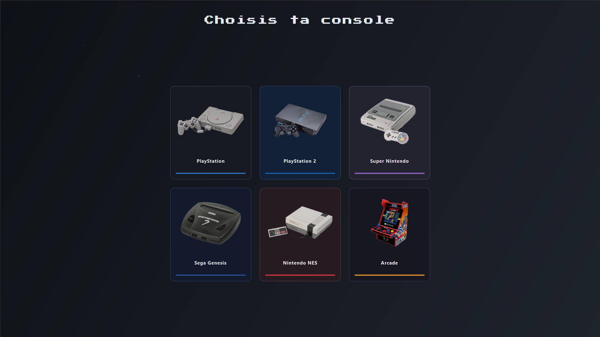
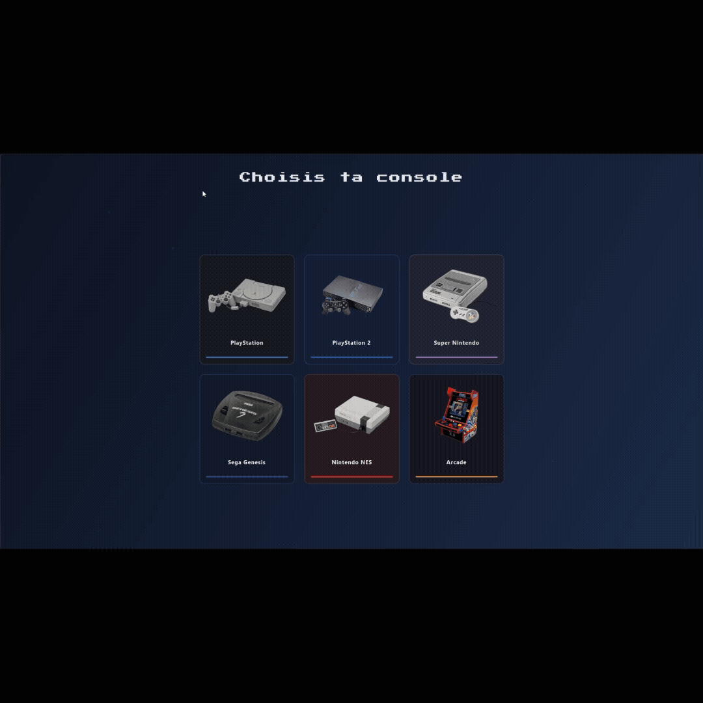

# Lunar Launcher

> **Note :** Ce projet est actuellement en cours de développement. Certaines fonctionnalités peuvent être incomplètes ou instables. Vos retours sont les bienvenus !

Un launcher multi-consoles pour emulateurs retro, avec une interface moderne et personnalisable.

## Fonctionnalites

- 🎮 Multi-consoles : PS1, PS2, SNES, NES, Genesis, GBA, Arcade
- 🔓 Support des ROMs 3DS (via decrypt_3ds.py)
- 🖼️ Grille de jeux avec jaquettes
- 📝 Descriptions editables par jeu
- ⭐ Favoris, notes et statuts (A jouer, En cours, Termine, Abandonne)
- 📊 Statistiques de temps de jeu et de sessions
- 📁 Playlists personnalisees
- 💾 Backup automatique des sauvegardes
- 🎨 Theme par console (palette de couleurs dediee)

## Prerequis

- **Python 3.11+**
- **PyQt6** (`pip install PyQt6`)
- **RetroArch** avec les cores appropries installes

## Installation

    git clone https://github.com/n3xus454/lunar-launcher.git
    cd lunar-launcher
    pip install -r requirements.txt
    python launcher.py

## Configuration

Au premier lancement, un fichier config.json est cree automatiquement.
Ouvre les parametres avec **Ctrl+Alt+P** pour configurer le chemin vers retroarch.exe, les cores, etc.

## Ou mettre les jeux

Place tes ROMs dans les dossiers correspondants : roms/ps1/, roms/ps2/, roms/snes/, roms/nes/, roms/genesis/, roms/gba/, roms/arcade/

## Important : ROMs et BIOS

Ce projet ne fournit **AUCUNE ROM ni AUCUN BIOS**.
Tu dois posseder legalement les jeux que tu utilises.

## Licence

MIT - voir le fichier LICENSE.

## Contribution

Les contributions sont bienvenues ! Lis CONTRIBUTING.md avant de soumettre une PR.

